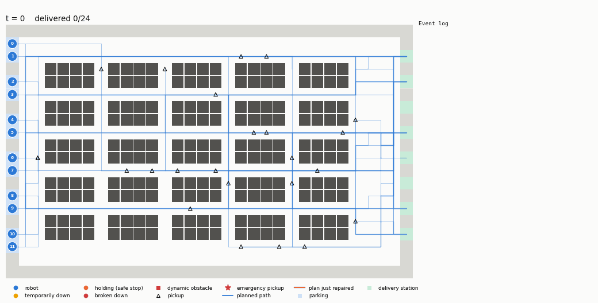

# PathWorks
A Negotiation-Based Plan Repair Framework for Multi-Agent Warehouse Navigation

A team of robots moves on a 2D warehouse grid, each picking up objects and
carrying them to delivery stations. Paths are planned with Space-Time A*.
While the plans are being executed, cells get blocked, robots break down and
emergency tasks arrive. The affected robots repair their plans locally,
negotiating with neighbours when they cannot solve the problem alone, without
re-running the multi-agent planner and while changing as few plans as possible.



## Running

Needs Python 3.10+ and matplotlib (the planner itself uses only the standard
library).

```bash
pip install -r requirements.txt

python main.py demo                         # one simulation, animated
python main.py demo --agents 20 --density 0.05 --seed 3
python main.py demo --save run.gif --no-show
python main.py demo --mode replan           # baseline: full replanning
python main.py experiments                  # sweeps -> results/
```

`python main.py demo --help` lists all options (team size, tasks per agent,
obstacle density, number of breakdowns and emergencies, share of temporary
disruptions, communication radius, delay tolerance, `--no-negotiation`).

## Model

- **Map** (`pathworks/grid.py`): 32 x 20 grid, 4-connected moves plus wait,
  one step per time step. Shelf blocks with one-cell aisles, a ring corridor,
  delivery stations on the right wall. Every robot has a private parking cell
  that no other robot may enter, so a parked robot never blocks anyone.
- **Tasks**: each robot has an ordered list of (pickup cell, delivery station)
  tasks and returns to its parking cell afterwards.
- **Conflicts**: two robots may not be in the same cell at the same time
  (vertex conflict) or swap cells (edge conflict).
- **Initial plan** (`simulation.py: plan_initial`): prioritized planning.
  Robots plan one by one with Space-Time A* (`planner.py`) over states
  (cell, time, next-goal index), reserving their path in a space-time
  reservation table. The heuristic is the exact BFS distance through the
  remaining goals.

## Disruptions

| Type | Effect |
|---|---|
| Blocked cell | An aisle cell becomes an obstacle, permanently or for a known duration. Robots whose remaining path uses it are disrupted. |
| Breakdown | Permanent: the robot becomes an obstacle, the object it carries is lost, and its not-yet-picked-up tasks are re-allocated. Temporary: it stands still for a number of steps. |
| Emergency task | A robot receives a high-priority pickup and delivery that it must serve before its other work. |

Random blockages never disconnect the warehouse and never land on a task's
pickup cell, so every task stays achievable.

## Plan repair algorithm (`pathworks/repair.py`)

Only disrupted robots react, and each one escalates only as far as needed:

0. **Self-repair.** The robot re-plans its own remaining route with Space-Time
   A*, treating every other robot's current plan as a hard reservation. If a
   route exists and costs at most `delay_tolerance` extra steps it is adopted
   and nobody else changes.
1. **Negotiation with neighbours.** Otherwise the robot plans a route in which
   collisions with robots inside its communication radius are allowed but
   penalised, which yields the route that needs the fewest neighbours to move.
   It sends a yield REQUEST to exactly the neighbours that route collides
   with. Each of them tries to re-plan around the proposal and answers ACCEPT
   (with its extra delay) or REJECT. A rejecting neighbour becomes a hard
   constraint and the initiator proposes again. The deal is committed only if
   it saves at least `gain_per_agent` steps per extra robot it alters compared
   with self-repair; an emergency task always takes the faster option.
2. **Broadcast.** The same protocol with the whole team as candidates.
3. **Safe stop.** The robot holds its cell and retries every few steps; robots
   routed through that cell repair themselves.

A broken robot's open tasks are re-allocated by a contract-net auction. Bids
are estimated completion times, with a penalty for robots whose plan is still
untouched, so the work goes to robots that already had to change. The winner
keeps its plan up to its last delivery and only plans the new tail.

Every step is a single-agent search against the reservations of the plans that
stay as they are. A final consistency check verifies that the joint plan is
collision-free after each repair.

## Evaluation

`python main.py experiments` runs 260 simulations (10 seeds per setting) and
writes `results/runs.csv`, `results/summary.csv` and the plots. Each run has
two tasks per robot, one permanent breakdown, one emergency task and
`density x (number of aisle cells)` permanent blockages at random times. The
baseline (`--mode replan`) discards all plans at every disruption and re-runs
prioritized planning for the whole team from the current positions.

Metrics:

- **Total time steps**: sum over robots of the time of their last delivery.
- **Plans changed per disruption**: robots whose remaining path differs after
  the repair, including the directly disrupted ones.

Team size, at 5% obstacle density:

| Robots | Original plan | Repair: total | Replan: total | Directly disrupted | Repair: plans changed | Replan: plans changed |
|---:|---:|---:|---:|---:|---:|---:|
| 5  | 438.0  | 484.1  | 497.4  | 1.17 | 1.21 | 1.47 |
| 10 | 900.5  | 966.8  | 968.4  | 2.03 | 2.06 | 2.96 |
| 20 | 1799.2 | 1945.5 | 1903.5 | 3.64 | 3.78 | 6.82 |
| 30 | 2826.5 | 3036.2 | 3082.2 | 5.60 | 5.79 | 12.98 |
| 40 | 3838.5 | 4140.5 | 4193.9 | 6.93 | 7.10 | 17.48 |

Obstacle density, with 20 robots:

| Density | Repair: total | Overhead | Replan: total | Repair: plans changed | Replan: plans changed |
|---:|---:|---:|---:|---:|---:|
| 0%   | 1813.8 | 0.8%  | 1809.8 | 2.85 | 12.20 |
| 2.5% | 1854.1 | 3.1%  | 1847.4 | 3.48 | 7.15 |
| 5%   | 1945.5 | 8.2%  | 1903.5 | 3.78 | 6.82 |
| 10%  | 2033.3 | 13.1% | 1971.1 | 3.47 | 6.56 |
| 15%  | 2360.3 | 31.2% | 2510.9 | 4.19 | 7.94 |

- Repair changes almost exactly the robots the disruption hit directly (about
  0.1 to 0.2 extra per disruption); full replanning changes about twice as
  many, and the gap widens with team size.
- Total time is within a few percent of full replanning in every setting,
  sometimes better and sometimes worse.
- By type, repair changes 3.8 plans for a blocked cell, 7.1 for a breakdown
  (this includes the robots that take over its tasks) and 1.6 for an emergency
  task; replanning changes 7.0, 12.6 and 12.9.
- No collisions occurred in any run. About 98% of tasks are delivered; the
  rest are mostly objects on board the robot that broke down.

## Layout

```
main.py                  command line entry point
pathworks/grid.py        warehouse map, dynamic obstacles, BFS distance maps
pathworks/planner.py     Space-Time A*, reservation table
pathworks/agent.py       Agent, Task, Goal
pathworks/simulation.py  initial planning, execution loop, metrics
pathworks/repair.py      plan repair, negotiation, auction, replan baseline
pathworks/scenario.py    instance and disruption generation
pathworks/visualize.py   animation
pathworks/experiments.py sweeps, CSV output, plots
```
